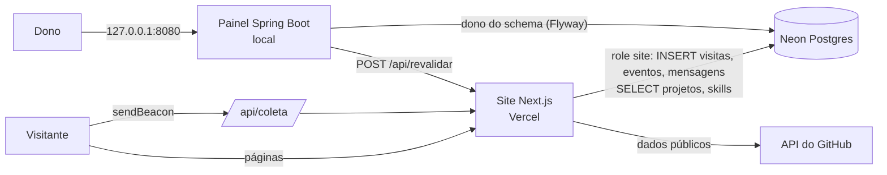

# Portfólio — João Gabriel

Site público bilíngue (PT/EN) de portfólio de desenvolvedor, com tema "sombra" em dois
modos (`dark` e `shiny`), mascote em SVG e cards de projeto "fantasma", mais um painel
administrativo local em Java.

## Stack

- **Site:** Next.js 16 (App Router, Turbopack), React 19, TypeScript estrito,
  Tailwind CSS v4 com tokens semânticos, next-intl (`/pt` e `/en`) e Zod
- **Banco:** Postgres no Neon, acessado pelo site com `@neondatabase/serverless` (SQL
  escrito à mão, sem ORM)
- **Painel:** Java 21, Spring Boot 3.5, Thymeleaf + HTMX, Chart.js, Spring JDBC e Flyway
- **Qualidade:** Vitest + Testing Library, Playwright + axe-core, Lighthouse CI,
  JUnit 5 + Testcontainers, GitHub Actions

## Arquitetura

- **Site estático com dados vivos.** As páginas são geradas com ISR (revalidação de
  1 hora). Projetos e skills vêm do banco; repositórios, linguagens e atividade vêm da
  API do GitHub. Se o banco ou o GitHub falham, o site usa o conteúdo de
  `src/content/` e continua no ar.
- **Painel só local.** O painel roda na máquina do dono, escuta apenas em `127.0.0.1` e
  não tem login. Um filtro recusa Host de fora (DNS rebinding) e escrita vinda de outro
  site (CSRF). Ao salvar, ele chama `POST /api/revalidar` com um segredo, e o site
  regenera as páginas na hora.
- **Banco com duas roles.** O painel é dono do schema e aplica as migrations (Flyway).
  O site usa a role `site`, que só insere visitas, eventos e mensagens e só lê projetos
  e skills: se essa credencial vazar, ninguém lê as mensagens nem apaga dados.
- **Limites no próprio banco.** Triggers limitam mensagens por visitante e por dia e
  descartam coleta excessiva, valendo mesmo para quem chama a API diretamente.
- **Analytics sem cookies.** O navegador envia a página vista e os cliques marcados
  com `data-evento` (repositório, aplicação, CV, idioma). O site não grava IP nem
  user-agent: só um hash com sal diário, que impede seguir o visitante entre dias.
  Não envia nada quando "Do Not Track" ou Global Privacy Control estão ativos.
- **Segredos só no servidor.** Nenhum segredo usa o prefixo `NEXT_PUBLIC_`; os logs registram
  só o tipo do erro, nunca dados de visitantes ou mensagens.

## Requisitos

- Node 22 ou superior e pnpm 12 (fixado em `packageManager`; use `corepack enable`)
- JDK 21 para o painel; Docker para os testes do painel

## Scripts

| Comando                        | O que faz                                              |
| ------------------------------ | ------------------------------------------------------ |
| `pnpm dev`                     | Servidor de desenvolvimento                            |
| `pnpm build`                   | Build de produção                                      |
| `pnpm lint`                    | ESLint                                                 |
| `pnpm typecheck`               | `next typegen` + `tsc --noEmit`                        |
| `pnpm test`                    | Testes unitários (Vitest)                              |
| `pnpm test:e2e`                | Testes e2e e axe (Playwright; faz build e sobe o site) |
| `pnpm db:seed-export`          | Gera o `seed.json` do painel a partir de `src/content` |
| `painel.cmd`                   | Sobe o painel (Windows)                                |
| `./mvnw verify` (em `painel/`) | Testes do painel                                       |

## Variáveis de ambiente

Todas ficam só no servidor; a lista comentada está em `.env.example` (site) e
`painel/.env.example` (painel). Sem banco, o site usa o conteúdo dos arquivos, esconde
o formulário de contato e não coleta visitas.
